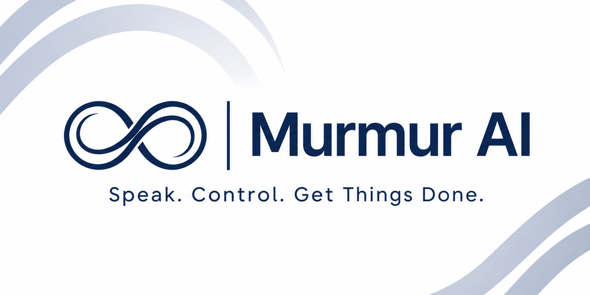

<div align="center">




# Murmur AI

**Talk to your computer and have it do the work. Runs entirely on your machine. Free, open source, and built for people who use a screen reader or no hands at all.**

[](LICENSE)
[](#installation)
[](#built-for-eyes-free-independence)
[](#architecture)

**[Download the latest release](https://github.com/MT25MB/MurmurAI/releases/latest)** ·
**[Website & docs](https://MT25MB.github.io/MurmurAI/)** ·
**[Contributing](#contributing)**

</div>

---

Murmur AI is a free assistant that lives on your desktop. You talk to it. It listens, looks at the screen, and clicks or types for you.

That matters most when the screen is hard to read. Screen readers lean on labels that developers add to buttons and menus. Plenty of apps skip those labels, or draw their interface on a canvas where labels don't exist. Murmur AI reads the screen as an image instead. It can find a button in Blender's viewport, walk through DaVinci's timeline, or tell you what's in a dialog box.

It starts when your computer boots. Local speech recognition turns your voice into text. A local model decides what to do. Local speech synthesis answers out loud. Say "what's on my screen?" and get a spoken description. Say "install Blender" and watch it happen.

Nothing is sent to a server. There's no subscription, no account, no API key, and no telemetry.

---

## Built for Eyes-Free Independence

Screen readers such as NVDA, VoiceOver, and Orca work from an accessibility tree. That tree only helps when developers label their controls. An app built on a timeline or a custom canvas often has no labels to read, and the user is left out.

Murmur AI looks at the screen instead.

* **Unlabeled apps.** It captures the screen, finds buttons and menus with OpenCV, numbers them, and clicks the one the model picks. That covers **Blender**, **DaVinci Resolve**, and browser apps.
* **Spoken descriptions.** Ask *"What's on my screen?"*, *"Did that download finish?"*, or *"Read the error dialog"*. You get a short answer out loud.
* **No push-to-talk.** It starts at boot and listens through local voice activity detection (`webrtcvad`, with optional Silero). Talk over it whenever you like to cut it off.
* **Confirmations out loud.** Before a destructive command, a file deletion, or an install, it reads the exact action and waits for you to say *"yes"*.

---

## What it can do

* **Voice in, voice out.** `webrtcvad` catches when you start and stop talking, `faster-whisper` turns the audio into text, and `Kokoro-82M` speaks the reply. Start talking mid-reply and it stops.
* **Set-of-Marks.** `mss` grabs a frame. OpenCV and OS accessibility APIs find the controls. Numbered boxes go on the image, the vision model (`qwen2.5-vl:7b`) picks a number, and `pyautogui` clicks or types.
* **Shortcuts first.** It checks which app is in front and uses that app's own hotkeys where it can. Fewer clicks, fewer mistakes.
* **Installing apps.** Say *"Install VLC"* or *"Install Blender"*. It searches `winget`, `brew`, `flatpak`, `snap`, `apt`, `dnf`, or `pacman`, shows you the command, and waits for your OK. If no package exists, it falls back to the browser.
* **Clipboard and recent files.** Ask *"What did I just copy?"*, *"Summarize my clipboard"*, or *"Copy that result to my clipboard"*. Say *"What did I just download?"* to hear recent files with sizes and types. Words like *"this"* and *"it"* resolve against the last file or app you mentioned in the session.
* **Files and documents by voice.** Ask *"Find my passport scan"* to hear matching filenames, folders and dates. Say *"Read report.pdf aloud"* or ask for a section of a text, Markdown, PDF or Word document. Batch move/copy/rename runs only after a spoken confirmation if anything would be overwritten, and never deletes files.

---

## Architecture

The desktop shell is **Tauri v2** (Rust with React and TypeScript). A Python sidecar runs beside it and talks over a local WebSocket at `ws://127.0.0.1:8765`.

```text
 [ Microphone ] ──► webrtcvad + Faster-Whisper (local STT)
                          │
                          ▼
              Ollama ReAct Brain (qwen2.5:7b)
              ┌───────────┴────────────┐
              ▼                        ▼
   Native OS & CLI Tools      Set-of-Marks Vision Loop
   (winget/brew/files)        (mss + OpenCV + qwen2.5-vl:7b)
              │                        │
              └───────────┬────────────┘
                          ▼
             Kokoro-82M TTS ──► [ Speakers ]
```

- **Shell:** Tauri v2, React, TypeScript, Tailwind. The HUD is a small transparent pill with a tray icon.
- **Sidecar:** Python 3.11 and FastAPI. States move through `IDLE → LISTENING → THINKING → SPEAKING`.
- **Models:** Ollama runs `qwen2.5:7b` for conversation and tool calls, `qwen2.5-vl:7b` for vision.
- **Voice:** faster-whisper (`base.en`, `int8`) for speech to text, Kokoro-82M for text to speech, with Piper or pyttsx3 as fallbacks.
- **Cache:** models and weights live in `~/.murmur-ai/models/`.
- **Network:** the only listeners are `127.0.0.1:8765` and Ollama at `127.0.0.1:11434`. Nothing phones home.

### Settings and self-diagnostics

Optional spatial audio cues give a short stereo blip positioned where Murmur is about to click (left/right by screen X, higher/lower by Y), with distinct chimes for waking, sleeping, success, confirmation and recovery. Toggle them with *"Turn spatial audio cues off"*.

Murmur pronounces acronyms naturally with a user-editable dictionary at `~/.murmur-ai/pronunciations.json` (`GUI` → "gooey", `sudo` → "soo-doo", `bpy` → "B-P-Y"). Say *"Pronounce 'nvda' as 'N-V-D-A'"* to add one on the fly. Named voice profiles (*default*, *clear*, *fast*, *quiet*) set rate, voice and chimes together; *clear* is tuned for screen readers. Every reply is also emitted as clean plain text into a dedicated polite live log for Braille displays.

Press **Ctrl+,** (or **Cmd+,** on macOS), or use the tray menu, to open the accessible settings panel. It stays in sync with `~/.murmur-ai/config.json` and controls speech rate, voice, chimes, screen-description detail, listening mode, microphone threshold and model selection. You can also just say **"Speak faster"**, **"Change your voice"**, **"Turn chimes off"**, **"Switch to detailed screen descriptions"**, **"Switch to wake-word mode"**, **"Increase mic threshold"**, **"Switch vision model to qwen3-vl"**, or **"Show current models"**.

Murmur AI won't listen to its own voice: TTS playback mutes voice detection with a short tail buffer, and an optional loopback device can ignore room audio. Enable *Lower media volume while speaking* to duck background media. Say **"Be quiet"** or **"Stop talking"** (or press **Q**, or **Ctrl/Cmd+Shift+Q**) to cut speech instantly.

#### Uninstall and your data

By default, uninstalling Murmur AI **keeps** your memories, chats, keys and settings in `~/.murmur-ai` so a reinstall picks up where you left off. To clear them instead, turn on **"Clear my data if Murmur AI is uninstalled"** in the settings panel, or say **"Clear my data when you are uninstalled"**. Say **"Keep my data when you are uninstalled"** to switch back, or **"What happens to my data when you are uninstalled"** to hear the current choice.

After uninstalling, the choice is applied by the bundled cleanup tool:

```bash
python scripts/uninstall_cleanup.py --apply
```

It is a dry run unless `--apply` is passed, and it only removes an explicit allowlist of data files (`memories.json`, config, keys, setup marker and logs). Downloaded model weights are never removed. The OS installers do not call this tool automatically; run it yourself after uninstall if you chose to clear your data.

Say **"Run diagnostics"** or **"Why aren't you working?"** for a plain-English spoken report on your microphone, Ollama, local models, OS permissions and display session. If you hit a bug, say **"Export diagnostics"**: Murmur builds a privacy-safe zip on your Desktop (logs, hardware profile, Ollama status and a sanitized config, with paths and secrets redacted) and speaks the exact path so you can attach it to a GitHub issue. Nothing is uploaded automatically. It can offer to fix missing permissions or restart Ollama by voice.

### Local MCP plugins

Murmur AI can load community [Model Context Protocol](https://modelcontextprotocol.io/) tools from servers that run entirely on your machine. Create `~/.murmur-ai/mcp_servers.json` using the standard stdio format (`command`, `args`, `env`):

```json
{
  "servers": {
    "notes": {
      "command": "python",
      "args": ["-m", "mcp_server_notes"],
      "env": { "NOTES_DIR": "/home/me/notes" },
      "allowlist": ["search_notes"],
      "enabled": true
    }
  }
}
```

A complete sample is written to `~/.murmur-ai/mcp_servers.example.json` on first launch (and lives in `backend/mcp_servers.example.json`). Each discovered tool is registered with the brain as `mcp__<server>__<tool>`. Tools that write files, contact the network, or run system actions ask for spoken confirmation before they run; put a tool in that server's `allowlist` to skip the prompt for a tool you trust.

Say **"What plugins or MCP tools are active?"** to hear what is loaded, or **"Reload my plugins"** to pick up config changes without restarting.

Full architecture rules live in [AGENTS.md](AGENTS.md).

---

## Installation

Download the installer for your platform from the **[latest release](https://github.com/MT25MB/MurmurAI/releases/latest)**:

| Platform | Installers |
| --- | --- |
| Windows | `.msi`, `.exe` |
| macOS | `.dmg` (Apple Silicon) |
| Linux | `.AppImage`, `.deb` |

Every installer is built from source by GitHub Actions in `.github/workflows/release.yml`.

One-line installs (manifests in `packaging/` are version/hash-synced by the release workflow):

```bash
# Windows (WinGet, once the manifest is in the WinGet repository)
winget install --id MT25MB.MurmurAI -e

# macOS (Homebrew, after tapping this repository)
brew tap MT25MB/murmur-ai https://github.com/MT25MB/MurmurAI
brew install --cask murmur-ai

# Linux (AppImage from the latest release)
curl -L -o MurmurAI.AppImage \
  https://github.com/MT25MB/MurmurAI/releases/latest/download/Murmur.AI_1.2.1_amd64.AppImage
chmod +x MurmurAI.AppImage && ./MurmurAI.AppImage
```

Every release also attaches `SHA256SUMS.txt`. Verify a downloaded installer with:

```bash
sha256sum -c SHA256SUMS.txt --ignore-missing
```

---

## Quick start

1. **[Install Ollama](https://ollama.com).** Setup checks for it and offers to install it if it's missing.
2. **Pull the two models.** Setup handles this with progress bars, or do it yourself:

   ```bash
   ollama pull qwen2.5:7b
   ollama pull qwen2.5-vl:7b
   ```

3. **Allow screen access.** On macOS, turn on Accessibility and Screen Recording. On Linux, you need X11 (XTest) or a Wayland portal. Windows needs nothing extra.
4. **Start talking.** Try *"Install Blender"*, *"What's on my screen?"*, or *"Open DaVinci and import the clips"*.

First launch also saves Whisper and Kokoro weights under `~/.murmur-ai/models/`.

---

## Hardware requirements

| Requirement | Minimum | Recommended |
| --- | --- | --- |
| OS | Windows 10, macOS 12, Linux (X11/Wayland) | Latest |
| CPU | 4 cores with AVX2 | 8 cores |
| RAM | 8 GB | 16 GB+ |
| Storage | ~8 GB free for models and weights | 20 GB SSD |
| GPU | Not needed; CPU inference works | NVIDIA or Apple Silicon for lower latency |
| Microphone | Any input device | Noise-cancelling |

---

## Privacy by design

* No cloud inference, no paid APIs, no analytics, no crash reporting.
* Audio, transcripts, and screenshots stay in memory or on your disk.
* Destructive actions wait for your OK, spoken or clicked.
* Clear local state whenever you want.

---

## Development

New to eyes-free use? Run `python scripts/demo.py --demo`, or just say **"Start tutorial"** to Murmur. It walks through four safe practice tasks and never changes files or settings.

Want to compare performance across a CPU, Apple Silicon Mac, or NVIDIA GPU? Run `python scripts/benchmark.py`. It writes a clean latency table to `BENCHMARKS.md`; missing models are reported as skipped rather than failing.

```bash
# App
npm install && npm run tauri dev

# Backend
cd backend && python -m venv .venv && pip install -r requirements.txt && python main.py
# verify: curl http://127.0.0.1:8765/health

# Website
cd website && npm install && npm run dev
```

See [CONTRIBUTING.md](CONTRIBUTING.md) for ground rules and the definition of done.

---

## Contributing

Contributions are welcome. Accessibility fixes, better screen grounding, and support for more apps all help. Read [CONTRIBUTING.md](CONTRIBUTING.md) before opening a pull request. Contributing means you agree to the [MIT License](LICENSE).

## License

[MIT](LICENSE) © Murmur AI contributors.

<div align="center"><sub>Made for getting things done on your own machine.</sub></div>
